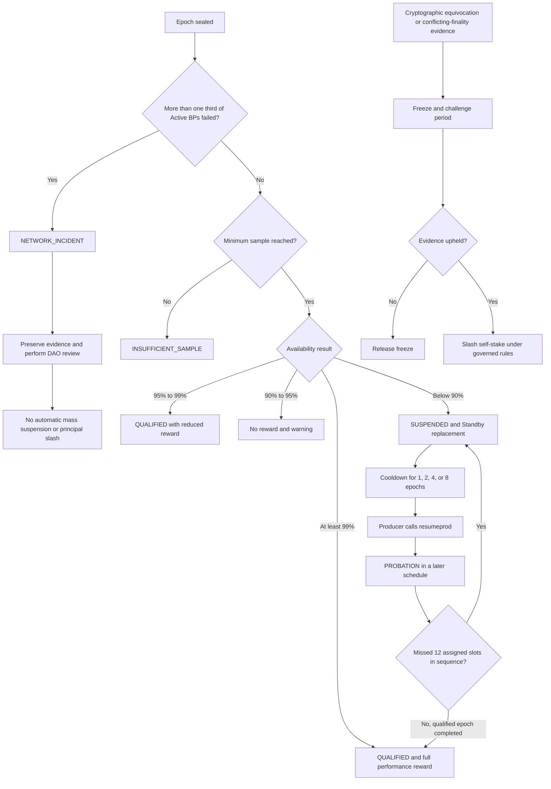
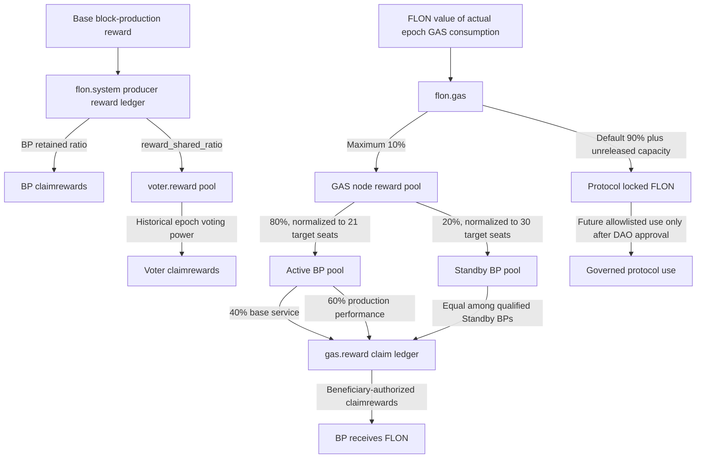

## Abstract

This proposal extends FLON's existing DPoS producer schedule with candidate self-staking, public registration metadata, normalized token-holder voting, a qualified standby pool, deterministic on-chain performance enforcement, epoch-based rewards, and timelocked DAO governance.

The active set has a final target of 21 block producers (BPs), but may launch with a smaller schedule, such as 3, and expand progressively. The `flon` system account controls the bounded `active_bp_quorum` parameter; this parameter means the number of active producers in the schedule, not the consensus-confirmation threshold. The qualified standby pool remains fixed at 30 throughout the rollout. Voters lock FLON and atomically receive an equal amount of non-transferable GLON governance receipts. One active GLON represents one unit of base governance power, but that power is divided equally among the selected candidates instead of being copied to every selection. A candidate that fails an objective availability threshold becomes ineligible regardless of historical vote rank. Ordinary downtime loses rewards and eligibility; stake slashing is reserved for cryptographically provable equivocation or conflicting-finality evidence.

All numeric values in this Draft are proposed defaults. They become normative only after simulation, review, and acceptance under FIP-0000.

## Motivation

Pure token-weight ranking can make the producer set difficult to contest: incumbents accumulate recognition and delegated stake, while a highly ranked but inactive producer may remain scheduled. Copying a voter's full weight to every selected candidate also multiplies influence according to ballot length.

FLON needs a system in which:

- one locked token creates only one unit of aggregate base voting power;
- candidates bear a meaningful self-stake and disclose verifiable operating information;
- new and standby operators have a defined path into production;
- poor performance overrides vote rank using deterministic chain data;
- issuance and rewards are auditable and supply-bounded;
- severe penalties require objective evidence; and
- governance changes are delayed, reviewable, and constrained by an action allowlist.

## Specification

### Terminology

This proposal uses **Block Producer (BP)** as the normative name for an elected protocol participant authorized to produce blocks. It does not use **Supernode** as a protocol role because that term is ambiguous across blockchain ecosystems.

- **Candidate BP**: a registered operator seeking qualification or election;
- **Active BP**: a qualified BP included in the current block-production schedule;
- **Standby BP**: a qualified BP outside the active schedule that remains eligible for observation, rewards, and deterministic promotion;
- **BP operator**: the accountable person or organization controlling the registered BP account and infrastructure; and
- **block-producing node**: a software or machine instance operated by a BP, not a synonym for the elected operator or account; and
- **GLON (Governance FLON)**: a non-transferable governance receipt minted one-for-one when FLON is locked for voting and burned when withdrawal is requested. GLON is not a liquid-staking asset or an independently redeemable market token.

`Validator` and `finalizer` MUST be used only for distinct consensus-validation or finality duties when the implementation defines those roles. User interfaces, contracts, indexers, and governance documents SHOULD use the BP terms above consistently. Marketing material MAY explain the role in plain language but SHOULD NOT introduce `Supernode` as a separate technical category.

### Candidate lifecycle

A candidate moves through the following states:

```text
registered -> qualified -> active | standby
qualified | active | standby -> suspended -> cooling -> standby -> qualified
registered | qualified | standby -> retiring -> withdrawn
```

An operator MUST satisfy all of the following before becoming `qualified`:

1. register a valid producer account and block-signing authority;
2. lock at least `min_bp_self_stake` from funds controlled by that operator;
3. publish all mandatory metadata;
4. accept the hash of the current service and penalty terms; and
5. register a valid finalizer authority when the active consensus mode requires one.

Self-stake MUST remain locked while a producer is active, under investigation, suspended, cooling, or awaiting a penalty decision. Normal retirement has a proposed 21-day withdrawal delay.

The reference implementation stores governance configuration in `bpstakecfg`, principal in `bpstakes`, and delayed withdrawals in `bpstkrefund`. `stakebp` locks core FLON, `unstakebp` starts the governed delay, and `claimbpstake` is an owner-authorized pull claim after maturity. Both producer registration entry points call the same internal `check_min_bp_self_stake` rule. When `enforce_schedule` is enabled, Active schedule selection and Standby snapshots use the same qualification predicate.

Initial activation SHOULD call `setbpstake(false, "500000.0000 FLON", 1814400)`. This immediately gates new and re-registering candidates while giving existing producers an announced funding window. Governance SHOULD enable schedule enforcement only after that window; otherwise a contract upgrade could remove several incumbent producers in the same schedule update. The `500,000 FLON` value is a governable launch parameter, not a compile-time constant or a permanent economic commitment.

### Candidate metadata

The system contract MUST retain an indexed record containing at least:

```text
owner, display_name, website, x_account, logo_uri,
country_code, region_code, organization,
p2p_endpoint, api_endpoint, node_version,
email_hash, terms_hash, metadata_hash,
commission_rate, updated_at, verified_at
```

`website` MUST use HTTPS and `x_account` MUST be present. The registered website SHOULD publish a challenge signed by the producer authority. Public email plaintext SHOULD NOT be stored on-chain. Metadata MUST be reconfirmed at least every 90 days; expiration makes the candidate ineligible without deleting its registration.

### Voting power

Locked FLON creates linear base power through GLON:

```text
account_base_power = active_GLON
account_effective_power = account_base_power * freshness_factor
vote_weight_per_bp = account_effective_power / selected_bp_count
raw_bp_weight = bp_self_stake + sum(vote_weight_per_bp)
ranking_bp_weight = min(raw_bp_weight, total_effective_vote_power * ranking_cap)
ranking_score = ranking_bp_weight * performance_factor
```

A voter MAY select at most 30 candidates. The voter's effective power MUST be divided equally among all selections. Implementations MUST use fixed-point or integer arithmetic with a documented deterministic remainder rule.

The proposed freshness schedule is:

| Time since confirmation | Ranking weight |
| --- | ---: |
| 0–90 days | 100% |
| 91–120 days | 75% |
| 121–150 days | 50% |
| 151–180 days | 25% |
| More than 180 days | 0% |

Confirming a ballot updates its timestamp but MUST NOT create additional power or reset the underlying token lock. The proposed ranking cap is 5% of total effective voting power per candidate. Power above the cap remains economically attributable to its owners but does not increase producer rank.

Changing a ballot MUST first settle rewards already confirmed by completed epochs against its previous allocation. Additions, removals, and candidate changes submitted during epoch `N` MUST be recorded as pending BP allocations and take effect for BP ranking and voter rewards at the start of epoch `N+1`. Voter withdrawal has a proposed seven-day delay. Producer selection MUST use an epoch-boundary snapshot, not the instantaneous order within a transaction block.

### GLON governance receipt

GLON is issued and accounted by the `flon.token` contract. The `flon` system account is the GLON issuer, and only the `flon.system` voting workflow may authorize its issuance, distribution, return, and retirement. This proposal does not require a separate `glon.token` contract.

GLON MUST use the same precision as FLON and MUST be minted at the fixed initial conversion ratio:

```text
1 locked FLON = 1 active GLON = 1 unit of base governance power
```

`flon.system::addvote` MUST atomically perform all of the following or revert the entire transaction:

```text
transfer FLON from voter to flon.vote
issue the same quantity of GLON to the flon issuer account
transfer that GLON from the issuer to the voter
increase the voter's active voting balance
update BP allocation and voter-reward accounting
```

`flon.system::subvote` MUST atomically perform all of the following or revert the entire transaction:

```text
return the requested GLON from the voter to the issuer with issuer authorization
retire the returned GLON
remove live DAO governance power and queue removal from the next BP epoch
settle or update voter-reward accounting
create the delayed FLON refund request
```

The withdrawal delay applies to the return of FLON, not to governance power. GLON is burned and live governance power ends when `subvote` succeeds; a voter MUST NOT use that GLON in a new DAO snapshot during the refund delay. Burning GLON MUST NOT retroactively remove reward entitlement already fixed by a completed or in-progress epoch snapshot. The withdrawal takes effect in BP ranking and reward allocation at the next epoch boundary.

GLON MUST be account-bound. `flon.token` MUST reject transfers between ordinary accounts. It MUST also reject a holder's direct transfer to the issuer unless the `flon` issuer authorizes the transfer as part of the system withdrawal workflow. Consequently, GLON MUST NOT be listed, pooled, lent, pledged, or treated as a generally transferable payment or liquid-staking asset.

The implementation MUST maintain and expose enough state to verify the following conservation invariant, subject only to an explicitly documented atomic migration state:

```text
GLON total supply
  = FLON held by flon.vote - FLON recorded in pending refund requests
  = total active governance power before ballot allocation and freshness adjustments
```

BP ballot allocation and DAO governance MAY consume the same active GLON base balance, but they MUST use separate actions, checkpoints, and decision rules. Using GLON in one governance domain MUST NOT consume, duplicate, or transfer its principal claim in the other domain.

### Producer selection and standby pool

The active schedule size is controlled by `active_bp_quorum`, with a proposed initial value of 3, a hard minimum of 3, and a hard maximum and final target of 21. The system contract MUST expose a bounded action equivalent to:

```text
setbpquorum(active_bp_quorum)
  require_auth(flon)
  require(3 <= active_bp_quorum <= 21)
  activate_at(next_epoch_boundary)
```

The `flon` authority SHOULD be governed by the chain's published multisig or governance permission rather than a single operational key. A parameter update MUST be announced and timelocked, MUST NOT change the schedule in the middle of an epoch, and MUST record the old value, new value, approval transaction, and effective epoch. Implementations and user interfaces MUST call this value the active producer count or Active BP quorum and MUST NOT confuse it with the confirmation threshold derived from the consensus protocol.

At the final value of 21, the proposed composition is:

- 15 stable seats selected by descending smoothed `ranking_score`;
- 4 competitive seats selected deterministically from the next ranked cohort; and
- 2 newcomer seats selected deterministically from eligible operators registered for no more than 180 days.

All seats MUST satisfy identical technical, stake, metadata, and performance requirements. Competitive and newcomer seats are not exemptions from qualification.

Before the active schedule reaches 21, the number of stable, competitive, and newcomer seats MUST be a separately reviewed bounded configuration whose sum equals `active_bp_quorum`; the final 15/4/2 split MUST NOT be mechanically applied to a smaller schedule. Each expansion stage and its seat composition MUST be published before activation.

The next 30 eligible candidates form an ordered standby pool at every active-schedule size. The standby count, qualification rules, observation scheduling, online-rate accounting, deterministic replacement order, and reward eligibility do not shrink when `active_bp_quorum` is below 21. A suspended active producer is excluded from the next proposed schedule, allowing the first eligible standby candidate to advance without increasing the configured active schedule size. A deterministic rotating cursor MUST be used for competitive/newcomer rotation until a protocol-level unpredictable randomness source is specified. A producer-influenced block hash MUST NOT be used as lottery randomness.

### Epoch timing and transition rules

The initial epoch duration is six hours. With the current proposed 500 ms slot interval, the contract MUST represent this as `43,200` slots:

```text
epoch_length_slots = 6 * 60 * 60 * 2 = 43,200
epoch_id = (current_slot - genesis_epoch_slot) / epoch_length_slots
```

Epoch calculation MUST use consensus slot numbers and MUST NOT use validator-local wall-clock time. If the protocol slot interval changes, governance MUST update `epoch_length_slots` through the same reviewed activation that changes the slot interval so that the intended elapsed duration remains explicit.

The epoch duration MAY be changed by governance within the hard range of two to 24 hours. An update MUST pass the applicable timelock, identify its effective epoch, and activate only at an old-epoch boundary. It MUST NOT resize or reinterpret an epoch that has already started. The initial six-hour value creates four settlement boundaries per day.

For a 500 ms slot interval, a six-hour epoch provides approximately the following expected sample sizes before missed slots:

| Active BP count | Expected slots per BP per epoch |
| ---: | ---: |
| 3 | 14,400 |
| 7 | approximately 6,171 |
| 15 | 2,880 |
| 21 | approximately 2,057 |

At each boundary, the implementation MUST seal the completed epoch before activating pending state for the next epoch. Sealing MUST be constant-time with respect to the number of BPs and voters. The ordering is:

```text
1. finalize slot, availability, and network-incident statistics
2. freeze the reward budget, eligibility aggregates, calculation denominators, and parameter hash
3. record deterministic rounding and funding limits without iterating over or paying beneficiaries
4. determine suspension, cooling, and standby promotion
5. activate pending ballots, withdrawals, commission changes, and schedule parameters
6. publish the next epoch's BP vote-weight and reward snapshots
```

An `addvote`, `subvote`, or `voteproducer` action submitted during epoch `N` MUST NOT change epoch `N` reward shares. A successful `subvote` immediately burns or freezes the returned GLON for live DAO use, while its already snapshotted epoch `N` reward entitlement remains claimable. A BP commission or reward-sharing change also takes effect no earlier than a published future epoch after satisfying its separate notice delay.

Operational and ranking windows are defined as counts of completed six-hour epochs:

| Window | Epoch count | Use |
| --- | ---: | --- |
| Epoch boundary | 1 epoch / 6 hours | seal reward inputs, eligibility, pending-state activation |
| Recovery observation | 4 epochs / 24 hours | post-suspension standby observation |
| Short performance | 28 epochs / 7 days | recent operational stability |
| Long performance | 120 epochs / 30 days | ranking factor and repeated-failure history |

Rankings SHOULD use a deterministic smoothing function over at least four completed epochs to reduce schedule churn. If more than one third of the active set fails in the same epoch, `sealepoch` MUST mark `NETWORK_INCIDENT` before applying producer-specific suspension. The epoch data remains auditable, but that epoch MUST NOT independently trigger mass suspension or principal slashing.

### Deterministic performance accounting

Eligibility penalties MUST be derived only from state that every validating node can replay. External monitoring, API latency, hardware telemetry, or human reports MAY produce alerts but MUST NOT directly suspend or slash a producer.

The chain exposes this read-only intrinsic:

```text
get_producer_slot_stats(from_slot, to_slot)
  -> [{
       producer,
       expected,
       produced,
       missed,
       longest_missed_streak,
       leading_missed_streak,
       trailing_missed_streak
     }]
```

The intrinsic MUST use only the validated active schedule, schedule version/effective boundary, block timestamps, and actual pending-block producer. It MUST NOT read network state, wall-clock time, an external oracle, or a non-consensus historical database.

The valid query interval begins after the current head slot and ends at the current pending block slot. Every slot before the pending slot in that interval is therefore a deterministic missed slot. Implementations MUST enforce a bounded range per call; the proposed bound is 100,000 slots. Leading and trailing missed-streak fields allow a contract to merge adjacent chunks without losing streak information.

On each block, `flon.system::onblock` MUST process the interval after its last accounted slot through the current pending slot and update per-producer epoch counters. It MUST NOT iterate over all voters or distribute individual rewards during `onblock`.

At the epoch boundary, a deterministic `sealepoch` action records immutable inputs and aggregates:

```text
bpstats:
  producer, epoch_id, expected_blocks, produced_blocks,
  missed_blocks, longest_missed_streak, status, warning_count

epochstats:
  epoch_id, start_slot, end_slot, schedule_hash,
  active_bp_count, failed_bp_count, network_incident, sealed
```

`sealepoch` MUST NOT scan the Active or Standby sets, transfer rewards, or require every BP to be settled. Per-BP counters and aggregate denominators MUST already be maintained incrementally. After sealing, each BP follows an independent state machine:

```text
UNSETTLED -> SETTLED -> CLAIMED
```

`settleprod(producer, max_epochs)` MUST be permissionless and process no more than the caller-specified, contract-bounded number of that producer's oldest sealed epochs. It MAY create producer and voter reward ledger entries but MUST NOT transfer a beneficiary's reward or change its recipient. `claimrewards(producer, max_epochs)` MUST require the producer's authority, MAY invoke the same internal settlement routine for that producer, and MUST then transfer only the producer's accumulated claimable balance.

There is no global settlement cursor and no mandatory `settlenext` or `finalizeepoch` gate. One producer's failure to settle or claim MUST NOT block another producer, the next epoch, or pending schedule activation. An epoch MAY be marked `FULLY_SETTLED` when its settled count reaches its immutable snapshot count, but that marker is audit metadata rather than a prerequisite for other operations.

Availability is `produced_blocks / expected_blocks`. Comparisons MUST use integer cross-multiplication rather than floating point.

The proposed decision order is:

```text
if expected_blocks < min_expected_blocks:
    status = INSUFFICIENT_SAMPLE
else if failed_bp_count * 3 > active_bp_count:
    status = NETWORK_INCIDENT
else if produced_blocks * 100 < expected_blocks * 90:
    status = SUSPENDED
    suspension_count += 1
    cooldown_epochs = min(2 ** (suspension_count - 1), 8)
    suspended_until = epoch_id + cooldown_epochs + 1
else:
    status = QUALIFIED
```

Network-incident protection MUST be evaluated before individual epoch suspension. A producer marked `SUSPENDED` MUST be excluded from election even when it has the highest voting weight. Expiry of `suspended_until` does not restore eligibility by itself. The producer MUST authenticate `resumeprod(producer)` after cooldown; that action moves it to `PROBATION`, after which the next deterministic schedule proposal may admit it if its ranking and all other qualifications remain valid.

Probation is a live production test, not an external uptime attestation. While a producer is in `PROBATION`, a trailing streak of 12 deterministically assigned missed slots (one full production turn) MUST immediately return it to `SUSPENDED`. The normal schedule proposal path removes it and advances the next eligible standby producer. A successfully completed probation epoch is classified by the ordinary availability thresholds. External probes MAY inform the operator but MUST NOT satisfy `resumeprod` or clear probation.

Repeated suspensions use an escalating cooldown of 1, 2, 4, then 8 epochs, capped at 8 epochs (48 hours with the initial six-hour epoch). The corresponding earliest recovery epochs are `N+2`, `N+3`, `N+5`, and `N+9` when the failure is recorded in epoch `N`. Suspension history remains auditable and does not automatically reset merely because a cooldown expires.

### Performance factor and downtime penalties

For qualified candidates, the proposed trailing 30-day ranking factor is:

| Availability | Factor |
| --- | ---: |
| at least 99.5% | 1.00 |
| 99%–99.5% | 0.98 |
| 97%–99% | 0.90 |
| 95%–97% | 0.75 |
| below 95% | 0 and ineligible |

Within a single epoch:

| Availability | Consequence |
| --- | --- |
| at least 99% | Full performance reward |
| 95%–99% | Linear performance-reward reduction |
| 90%–95% | No BP or associated voter reward; one warning |
| below 90% | No reward; suspended, standby replacement, and explicit recovery required |
| Repeated suspension | Cooldown escalates 1, 2, 4, then 8 epochs |
| Probation misses 12 consecutive assigned slots | Immediate deterministic re-suspension |

Downtime MUST NOT by itself slash principal in the initial version.

The normative penalty and recovery flow is summarized below:



### GAS-derived FLON rewards

Node rewards are denominated and paid directly in FLON. ELON is not minted, credited, redeemed, or used as a reward claim. For each completed epoch, the protocol measures the increase in cumulative GAS fees expressed in FLON smallest units:

```text
epoch_gas_flon = cumulative_gas_value_flon(end) - cumulative_gas_value_flon(start)
epoch_reward_cap = floor(epoch_gas_flon * 10 / 100)
```

The default reward cap is 10% of the epoch's measured GAS value. The remaining 90% stays in `flon.gas` as protocol-owned locked FLON until an accepted DAO proposal assigns an allowlisted use. Governance MAY change this split for future epochs within accepted hard bounds, but MUST NOT retroactively change settled rewards.

The default 10% reward pool is divided as follows:

| Recipient | Share of reward pool | Share of epoch GAS value | Basis |
| --- | ---: | ---: | --- |
| Eligible Active BP pool | 80% | 8% | Target-seat normalized; then 40% equal base service and 60% produced-block performance |
| Qualified Standby BP pool | 20% | 2% | Target-seat normalized; equal among Standby BPs meeting the proof threshold |
| FLON retained in `flon.gas` | n/a | 90% plus unreleased reward capacity | Locked by default |

These percentages are maximum allocations at the final target of 21 Active BPs and 30 qualified Standby BPs. A smaller or partially eligible set MUST NOT divide the full reward cap. Epoch settlement MUST use target-seat normalization:

```text
N = min(eligible_active_count, 21)
S = min(qualified_standby_count, 30)
G = epoch_gas_flon
R = floor(G * 10 / 100)

active_cap  = floor(R * 80 * N / (100 * 21))
standby_cap = floor(R * 20 * S / (100 * 30))
released_reward = active_cap + standby_cap
unreleased_reward_capacity = R - released_reward
```

With 3 eligible Active BPs and 30 qualified Standby BPs, no more than `8% * 3 / 21 + 2% = 3.142857%` of epoch GAS value is released, rather than the full 10%. The remaining `6.857143%` reward capacity, plus the ordinary 90% retained share, stays in `flon.gas`.

Within `active_cap`, 40% is the equal base-service pool and 60% is the produced-block performance pool. An Active BP below the configured availability threshold receives neither component. A Standby BP must submit the configured number of spaced proofs against recent canonical blocks; qualification MUST be determined from the completed epoch snapshot.

At epoch sealing, `released_reward` MUST be reserved without paying individual BPs. An implementation MAY fund `gas.reward` with the sealed upper bound or transfer each BP's deterministically allocated amount when that BP is independently settled, provided the accounting remains fully collateralized and atomic. `gas.reward` records each BP's allocated, claimed, and unclaimed FLON; an eligible BP withdraws accumulated rewards with `gas.reward::claimrewards`. Missed settlements or claims remain available and do not expire merely because a later epoch is sealed.

All FLON rewards use a beneficiary-authorized pull-claim model. Epoch sealing or independent producer settlement MAY fund a reward contract and update its accounting tables, but MUST NOT transfer rewards directly to a BP, Standby BP, voter, or other end user. Active and Standby BPs claim GAS-derived rewards with `gas.reward::claimrewards`; BPs claim legacy production rewards with `flon.system::claimrewards`; voters claim their allocated share with `voter.reward::claimrewards`. Each payout action MUST require the beneficiary's authority. A third party MAY call `settleprod` to prevent a non-responsive BP from delaying voter accounting, but it MUST NOT receive, redirect, or trigger beneficiary funds. Unsolicited reward airdrops, automatic per-epoch payouts, and expiring unclaimed balances are prohibited.

The reward sources, pools, default ratios, and claim paths are summarized below:



The 80%/20% values are shares of the 10% GAS node reward cap, not shares of all GAS value. Target-seat normalization prevents a small launch schedule from dividing the entire cap. GAS-derived BP rewards do not enter `voter.reward` unless a separately reviewed future rule explicitly enables that path.

Any capacity not released because of vacant seats, failed performance, insufficient Standby proofs, ineligibility, or integer rounding MUST stay in `flon.gas`. It MUST NOT be redistributed among other BPs, carried forward as a later BP windfall, or used to increase the per-seat cap. Every multiplication MUST be overflow-checked and every division MUST round down.

GAS-derived BP rewards are separate from voter-sharing rewards. The existing producer/voter reward path may route a disclosed `reward_shared_ratio` through `voter.reward`, but `gas.reward` does not implicitly create voter entitlement. Adding voter sharing to GAS-derived rewards requires a separately reviewed rule and immutable epoch vote snapshot.

### Provable misconduct and slashing

Principal slashing is limited to evidence that the chain can validate deterministically, such as:

- two conflicting block signatures for the same height and round;
- conflicting finality signatures; or
- a deliberately malformed evidence submission where a separately specified anti-spam rule applies.

The process is `submit evidence -> verify -> freeze -> challenge period -> execute`. A DAO vote MUST NOT substitute for cryptographic verification. The proposed challenge period is 48 hours. Proposed slash rates are 5% for a first offense, 20% for a second offense within one year, and permanent exclusion for a third. Proposed proceeds are 50% burn, 40% security reserve, and 10% capped reporter reward.

The exact evidence format and verifier require a follow-up FIP before slashing can be activated.

### DAO governance

Producer election and DAO governance share the active GLON staking/checkpoint infrastructure but use separate actions, thresholds, and executors. Governance voting uses the GLON balance and any separately specified delegation state from the epoch preceding proposal creation. GLON minted, burned, or delegated after that snapshot MUST NOT change voting power for the proposal. Governance delegation MAY assign voting power, but MUST NOT transfer GLON, locked FLON principal, withdrawal rights, or reward ownership.

The proposed classes are:

| Proposal class | Approval | Quorum | Timelock |
| --- | ---: | ---: | ---: |
| Ordinary parameter | more than 50% yes | 10% | 3 days |
| Treasury or contract upgrade | at least 66.7% yes | 20% | 7 days |
| Emergency pause | 5-of-7 security council | n/a | immediate, expires in 7 days |

The governance executor MUST use an action allowlist. Ordinary proposals MUST NOT transfer user stake, retroactively alter settled rewards, bypass the timelock, expand their own authority, or execute arbitrary system actions.

`active_bp_quorum` is a bounded system parameter administered through the `flon` account permission. Its allowlisted setter MUST enforce the 3-to-21 range and epoch-boundary activation. Changing it does not alter the fixed 30-member qualified standby pool. Any associated stable, competitive, and newcomer seat counts MUST sum exactly to the new active producer count.

The recommended contract separation is `flon.gov`, `flon.proposal`, `flon.treasury`, and `flon.timelock`. Existing mDAO code MAY provide data-model ideas but MUST be audited, have AMAX-specific dependencies removed, and use FLON-specific accounts and permissions before deployment.

## Rationale

Normalized allocation preserves the intuitive meaning of one token producing one aggregate unit of base power while still allowing diversification across up to 30 candidates. Freshness decay and a ranking cap reduce inert vote banks and concentration without confiscating delegated ownership.

Performance qualification is intentionally applied after voting: stake signals community preference, while deterministic availability establishes whether a candidate is capable of serving. A top-ranked but non-performing candidate therefore cannot permanently occupy a BP seat.

Downtime first affects rewards and eligibility because network partitions and operational failures can be ambiguous. Slashing is reserved for unambiguous signed evidence. The standby pool gives the schedule a replacement path without lowering qualification standards.

## Backwards Compatibility

Existing producer registration, voting, and reward tables require migration or versioned parallel tables. The implementation MUST specify how existing votes are normalized, how historical reward debt is settled, and when legacy actions stop accepting transactions.

At activation, each legacy voter MUST receive GLON equal to FLON that remains actively locked for voting. FLON already present in a pending refund request MUST NOT mint GLON. Migration MUST be deterministic and atomic, or use a versioned migration state that disables voting and withdrawal until the published locked-FLON, GLON-supply, and refund totals reconcile. The migration checksum and aggregate reconciliation values MUST be published before voting resumes.

The statistics intrinsic is a consensus-visible host function. All validating nodes MUST run compatible software before any deployed contract imports or calls it. A contract-only deployment before validator readiness can cause block validation failure and is prohibited.

Wallets and indexers that do not understand the new metadata continue to read legacy chain data but cannot reliably display eligibility, standby state, normalized allocation, or epoch rewards.

## Security Considerations

- All arithmetic MUST be overflow-checked and deterministic; floating point is prohibited in consensus calculations.
- GLON issuance, transfer to a voter, return, retirement, vote accounting, and refund creation MUST be atomic; partial completion MUST be impossible.
- The token contract MUST enforce GLON transfer restrictions at the asset layer rather than relying only on wallet or frontend behavior.
- Direct holder-to-issuer GLON transfers MUST require issuer authorization so that users cannot bypass `subvote`, strand receipts, or desynchronize receipt supply from active voting principal.
- Schedule-transition slots MUST be attributed using the schedule effective at each individual slot.
- Empty schedules, insufficient samples, long outages, and chunk boundaries MUST be explicitly tested.
- Network-wide incident protection MUST run before producer-specific punishment.
- Metadata URLs are untrusted input and MUST NOT be fetched by consensus code.
- Governance execution MUST have an allowlist, bounded parameters, timelocks, and expiring emergency authority.
- Evidence challenges MUST freeze only the accused operator's withdrawable self-stake and MUST define duplicate-evidence handling.
- Reward accounting MUST prove conservation across measured GAS value, the 10% reward cap, Active and Standby target-seat normalization, amounts transferred to `gas.reward`, BP claims, FLON retained in `flon.gas`, and integer rounding.
- `gas.reward` MUST NOT allocate or pay more FLON than it has received from `flon.gas`; failed transfers MUST roll back claimed and unclaimed ledgers atomically.

## Economic and Governance Considerations

Before this proposal advances to `Review`, maintainers MUST publish simulations using current supply distribution and historical producer data. At minimum, the report must compare:

- vote concentration before and after normalized allocation;
- sensitivity to the 5% ranking cap and freshness schedule;
- newcomer/competitive-seat churn;
- expected FLON node rewards under multiple Active/Standby counts, performance distributions, and GAS-consumption rates;
- `flon.gas` retained balance under reward claims, GAS consumption, and governance-parameter stress scenarios;
- voter returns at different BP commissions and availability rates; and
- coordinated-voter and multi-account Sybil scenarios.

The first implementation uses a governance-set absolute floor, initially proposed at `500,000 FLON`, with a 21-day withdrawal delay. Governance SHOULD later evaluate the greater of an absolute floor and a percentage of circulating supply. The percentage formula and its bounds still require explicit acceptance and are not active parameters.

## Test and Acceptance Criteria

The proposal cannot advance to `Implemented` until all of the following are linked from this document or its status-transition pull request:

1. deterministic unit tests for slot attribution, schedule transitions, long gaps, chunk merging, and integer threshold boundaries;
2. replay equivalence across at least two independently operated nodes;
3. system-contract tests for normalized voting, GLON mint/burn and 1:1 conservation, transfer restrictions, withdrawal atomicity, six-hour/43,200-slot boundaries, pending vote activation, completed-epoch reward preservation, caps, freshness, snapshots, suspension, cooling, and standby re-entry;
4. reward-conservation, 3-to-21 Active BP normalization, 0-to-30 qualified Standby normalization, integer-remainder retention, FLON funding, claim rollback, and `flon.gas`/`gas.reward` balance property tests;
5. migration tests from a representative mainnet snapshot, including active legacy votes, pending refunds, zero balances, and aggregate GLON reconciliation;
6. governance allowlist, Active BP quorum bounds, epoch-boundary activation, standby-count invariance, timelock, and emergency-expiry tests;
7. at least 30 continuous days on testnet with fault injection;
8. an external security review covering chain, contracts, and economics; and
9. a signed operational readiness report from the required validator threshold.

Post-activation acceptance requires that actual schedules match the top eligible set, independent replay reproduces epoch statistics, supply remains within caps, and a simulated suspension promotes the expected standby producer.

## Activation and Rollback

Deployment is phased:

1. GLON token definition, legacy-vote migration, metadata, self-stake, and normalized voting on testnet without new reward issuance;
2. statistics intrinsic and epoch accounting on testnet;
3. reward accounting and suspension/standby behavior on testnet;
4. mainnet launch with a governance-selected Active BP quorum, proposed initially as 3, followed by separately announced epoch-boundary expansions toward 21 while retaining 30 standby BPs;
5. DAO executor with narrowly allowlisted non-critical parameters; and
6. separately reviewed evidence-based slashing.

Mainnet activation MUST use an announced protocol feature, block height, or time after the required validator threshold confirms compatible binaries. The system-contract deployment transaction, code hash, ABI hash, table-migration checksum, and authority approvals MUST be published.

Before activation, rollback consists of not activating the feature and restoring the prior tested contract. After irreversible table migration or consensus activation, rollback MUST use a pre-audited compatibility release and governance-approved recovery transaction; operators MUST NOT independently downgrade consensus code. A pause switch MAY stop new elections, rewards, or governance execution but MUST NOT alter finalized chain history or user balances.

## Reference Implementation

Implementation work is expected in:

- [flon-core](https://github.com/fullon-labs/flon-core) for the deterministic producer-slot statistics intrinsic and consensus registration;
- [flon-cdt](https://github.com/fullon-labs/flon-cdt) for contract-facing C/C++ intrinsic bindings;
- the FLON system and reward contracts for election, GLON lifecycle authorization, epoch, qualification, and accounting logic;
- [`flon.token`](https://github.com/fullon-labs/flon.contracts) for GLON issuance, balance accounting, retirement, and protocol-enforced transfer restrictions; and
- the FLON explorer/API repositories for public candidate, epoch, reward, and governance views.

The intrinsic prototype has been implemented locally and compiled against `eosio_chain` and `funod`; it is not an accepted or activated protocol change. Immutable implementation pull requests and commits MUST replace this note before the proposal advances to `Implemented`.

## References

- [NEAR Protocol economics](https://nomicon.io/Economics/Economics.html)
- [NEAR EpochManager](https://nomicon.io/BlockchainLayer/EpochManager/)
- [Avalanche validator staking](https://build.avax.network/docs/primary-network/validate/how-to-stake)
- [Avalanche validator manager contracts](https://build.avax.network/docs/avalanche-l1s/validator-manager/contract)
- [RFC 2119](https://www.rfc-editor.org/rfc/rfc2119)
- [RFC 8174](https://www.rfc-editor.org/rfc/rfc8174)
